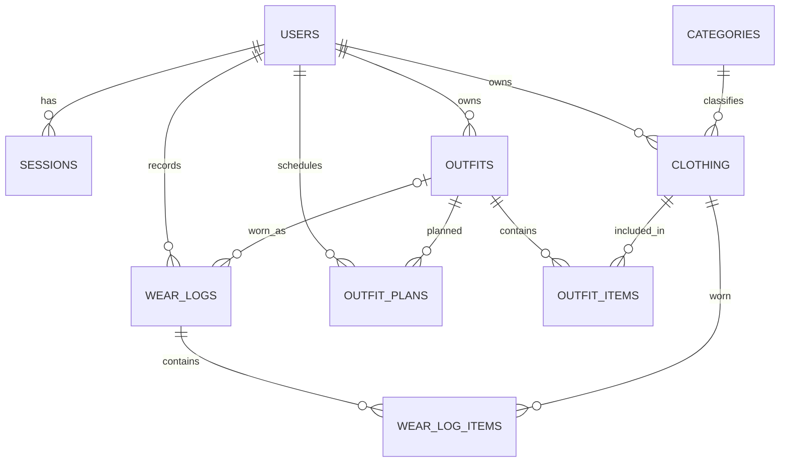

# Xây dựng phát triển hệ thống quản lý tủ quần áo thông minh

Ứng dụng web toàn diện giúp người dùng số hóa tủ đồ cá nhân, quản lý quần áo, phối đồ (outfit), lên kế hoạch trang phục hàng ngày, ghi nhật ký mặc đồ và nhận gợi ý phối đồ thông minh dựa trên dữ liệu thực tế.

## 1. Kiến trúc hệ thống

```text
Trình duyệt Web
 └── React Components ──► custom hooks (React Query) ──► Axios Client
                                                              │ (Cookie + CSRF Header)
                                                              ▼
                                                   Vite Proxy / Nginx
                                                              ▼
                                                   NestJS Controller
                                                              ▼
                                                        Service Layer
                                                              ▼
                                                    TypeORM Data Source
                                                              ▼
                                                    MariaDB Database
```

Hệ thống áp dụng kiến trúc phân lớp (Layered Architecture):
- **Giao diện (View)**: Xây dựng bằng React SPA, xử lý trải nghiệm tương tác của người dùng.
- **Bộ điều khiển (Controller)**: Định tuyến endpoint, kiểm tra quyền truy cập (Guards) và nhận request.
- **Nghiệp vụ (Service)**: Xử lý quy tắc nghiệp vụ, tính toán gợi ý phối đồ, kiểm tra quyền sở hữu dữ liệu.
- **Dữ liệu (Model / Repository)**: Thực thể TypeORM tương tác với cơ sở dữ liệu quan hệ MariaDB.

---

## 2. Cơ sở dữ liệu và Mô hình quan hệ

Cơ sở dữ liệu `digital_wardrobe` gồm các bảng chính:
- `users`: Thông tin tài khoản, mật khẩu băm và vai trò (`user`, `admin`).
- `sessions`: Phiên đăng nhập có khả năng thu hồi từ máy chủ.
- `categories`: Danh mục phân loại dùng chung (Tops, Bottoms, Outerwear, Dresses, Shoes, Accessories).
- `clothing`: Quần áo cá nhân, mùa, loại trang phục, màu sắc, ảnh và chu kỳ chăm sóc.
- `outfits`: Bộ trang phục hoàn chỉnh được phối từ các món đồ.
- `outfit_items`: Quan hệ nhiều-nhiều giữa outfit và từng món quần áo.
- `wear_logs` & `wear_log_items`: Nhật ký mặc trang phục thực tế theo ngày.
- `outfit_plans`: Lịch dự định mặc theo ngày và dịp cụ thể.
- `rate_limit_hits` & `rate_limit_counters`: Quản lý giới hạn request lưu trong database.



---

## 3. Danh sách API chính

Các API nghiệp vụ yêu cầu xác thực phiên qua Cookie `HttpOnly`, ngoại trừ đăng ký, đăng nhập, quên/đặt lại mật khẩu và `GET /health`. Khi gọi trực tiếp backend, đường dẫn không có tiền tố `/api`; frontend thêm `/api` và proxy tới backend:

| Group | Method & Route | Mục đích / Chức năng |
|---|---|---|
| **Auth** | `POST /auth/register`, `POST /auth/login` | Tạo tài khoản, đăng nhập và khởi tạo phiên |
| **Auth** | `GET /auth/session`, `POST /auth/logout`, `POST /auth/change-password` | Kiểm tra trạng thái phiên, đăng xuất, đổi mật khẩu |
| **Auth** | `POST /auth/forgot-password`, `POST /auth/reset-password` | Gửi và xác thực token đặt lại mật khẩu |
| **Profile** | `GET/PATCH /user/me` | Xem và cập nhật hồ sơ người dùng hiện tại |
| **Admin User** | `GET /user/admin`, `PATCH /user/admin/:id/role`, `DELETE /user/admin/:id` | Phân trang danh sách, cập nhật vai trò, xóa tài khoản (chỉ admin) |
| **Clothing** | `GET/POST /clothing`, `GET/PATCH/DELETE /clothing/:id` | CRUD quần áo, lọc theo danh mục/mùa/loại, tìm kiếm và phân trang |
| **Images** | `POST /clothing/images` | Upload ảnh quần áo (hỗ trợ JPEG/PNG/WebP, tối đa 5 MB) |
| **Category** | `GET /category`, `GET /category/page`, `GET /category/:id` | Đọc danh mục, phân trang |
| **Category (Admin)** | `POST/PATCH/DELETE /category[/:id]` | Thêm, sửa, xóa danh mục (chỉ admin) |
| **Outfit** | `GET /outfit/page`, `GET/POST /outfit`, `GET/PATCH/DELETE /outfit/:id` | CRUD bộ trang phục và phân trang |
| **Outfit Item** | `GET/POST /outfit-item`, `GET/PATCH/DELETE /outfit-item/:id` | Thêm, sửa, xóa từng món đồ trong outfit |
| **Dashboard** | `GET /activity/dashboard`, `GET /activity/recommendations` | Thống kê số lượng, mức sử dụng và gợi ý phối đồ theo luật |
| **Wear Logs** | `GET/POST /activity/logs`, `PATCH/DELETE /activity/logs/:id` | CRUD lịch sử và nhật ký mặc đồ theo ngày |
| **Outfit Plans** | `GET/POST /activity/plans`, `PATCH/DELETE /activity/plans/:id` | CRUD kế hoạch outfit theo ngày/dịp (lọc tối đa 366 ngày) |
| **Clothing Care** | `PATCH /activity/clothing/:id/care` | Cập nhật ngày giặt, ngưỡng nhắc và hướng dẫn chăm sóc |

### Kiểm thử API bằng Postman

Import collection [Digital-Wardrobe.postman_collection.json](./backend/postman/Digital-Wardrobe.postman_collection.json) vào Postman (**Import → File**), sau đó:

1. Khởi động MariaDB/MySQL và backend theo hướng dẫn cài đặt. Backend mặc định chạy ở `http://localhost:3000`.
2. Mở collection **Digital Wardrobe API - CRUD and Business Operations**, sửa biến `baseUrl` nếu backend chạy ở địa chỉ/cổng khác. Khi gọi trực tiếp backend, URL **không** có tiền tố `/api`; tiền tố đó chỉ được dùng qua proxy frontend.
3. Bảo đảm database đã nạp dữ liệu danh mục mẫu. Collection tự lấy `category_id` đầu tiên từ `GET /category`.
4. Chạy collection bằng **Run** theo thứ tự request. Collection tạo tài khoản thử nghiệm riêng, đăng nhập bằng cookie session, tạo và cập nhật quần áo/outfit/nhật ký/lịch kế hoạch, rồi xóa dữ liệu thử. Các ID được lưu tự động giữa các request.
5. Xem tab **Test Results** trong Collection Runner. Mỗi request kiểm tra mã HTTP và một số thuộc tính quan trọng trong response.

Collection gửi header `X-Wardrobe-Request: 1` cho request để thay đổi dữ liệu; backend từ chối `POST`, `PATCH`, `DELETE` nếu thiếu header này (HTTP `403`). Postman giữ cookie `dw_session` nhận được khi đăng ký/đăng nhập trong cookie jar; không cần gửi token thủ công. Các request cần đăng nhập sẽ trả `401` nếu cookie hết hạn (phiên mặc định 15 phút) hoặc cookie jar bị tắt.

Luồng kiểm thử bao gồm:

- Đăng ký, kiểm tra phiên hiện tại và đăng nhập.
- CRUD quần áo và cập nhật thiết lập chăm sóc.
- CRUD outfit và các món quần áo thuộc outfit.
- Tạo/cập nhật/xóa nhật ký mặc đồ và kế hoạch outfit; dashboard và gợi ý phối đồ.
- Dọn dữ liệu thử nghiệm và đăng xuất ở cuối collection.

Các API quản trị như `POST/PATCH/DELETE /category` và `/user/admin` cần phiên có role `admin`; collection thông thường không thay đổi dữ liệu quản trị. Upload ảnh `POST /clothing/images` cần body kiểu `form-data`, key `image`, file ảnh JPEG/PNG/WebP không vượt quá 5 MB.

---

## 4. Cơ chế Bảo mật

- **Mật khẩu an toàn**: Toàn bộ mật khẩu được băm bằng thuật toán `bcrypt` kèm salt ngẫu nhiên; không lưu mật khẩu dạng văn bản rõ.
- **Xác thực phiên (Session-based JWT)**: Token JWT được lưu trong Cookie bảo mật (`HttpOnly`, `SameSite=Lax`, `Secure` trên production). Server đối chiếu session trong DB mỗi request, cho phép thu hồi phiên tức thời khi đăng xuất hoặc đổi mật khẩu.
- **Phòng chống CSRF**: Bảo vệ các request thay đổi dữ liệu (POST/PATCH/DELETE) thông qua header tùy biến `X-Wardrobe-Request: 1`.
- **Phân quyền chặt chẽ (Ownership Verification)**: API luôn kiểm tra `user_id` từ phiên đăng nhập, ngăn chặn việc truy cập hoặc thao tác trên đồ của người dùng khác.
- **Rate Limiting**: Giới hạn số lần đăng nhập, đăng ký và gửi yêu cầu để chống brute-force và lạm dụng API.

---

## 5. Hướng dẫn cài đặt và khởi chạy

### Yêu cầu môi trường
- **Node.js**: `>= 24.9.0` (khuyên dùng Node.js 24 LTS)
- **Trình quản lý gói**: `npm`
- **Cơ sở dữ liệu**: MariaDB hoặc MySQL
- **Git**

---

### Khởi chạy nhanh (Local Development)

#### 1. Clone repository và cài đặt thư viện
```bash
git clone https://github.com/Whales88888/Digital-Wardrobe-Group.git
cd Digital-Wardrobe-Group

# Cài dependencies theo lockfile
npm --prefix frontend ci
npm --prefix backend ci
```

#### 2. Khởi động Cơ sở dữ liệu và nạp dữ liệu mẫu
- **Trên macOS (dùng Homebrew)**:
  ```bash
  brew services start mariadb
  mariadb -u root -e "CREATE DATABASE IF NOT EXISTS digital_wardrobe;"
  mariadb -u root digital_wardrobe < sql/digital_wardrobe.sql
  ```
- **Trên Linux / Ubuntu**:
  ```bash
  sudo service mariadb start
  mariadb -u root -p -e "CREATE DATABASE IF NOT EXISTS digital_wardrobe;"
  mariadb -u root -p digital_wardrobe < sql/digital_wardrobe.sql
  ```

#### 3. Cấu hình biến môi trường
Tạo file cấu hình cho backend:
```bash
cp backend/.env.example backend/.env
```
Mở file `backend/.env` và cập nhật thông số kết nối cơ sở dữ liệu:
```env
DB_HOST=127.0.0.1
DB_PORT=3306                  # Cổng MariaDB/MySQL local mặc định
DB_USER=your_local_user
DB_PASSWORD=your_local_password
DB_NAME=digital_wardrobe
PORT=3000
TRUST_PROXY_HOPS=0
JWT_SECRET=replace_with_a_random_secret_at_least_32_characters
IMAGE_STORAGE_DIR=uploads
FRONTEND_URL=http://localhost:5173
```
Không dùng nguyên các giá trị ví dụ cho môi trường production; đặt một `JWT_SECRET` ngẫu nhiên dài ít nhất 32 ký tự. Tạo user database riêng với quyền trên `digital_wardrobe` thay vì dùng tài khoản root.

#### 4. Khởi chạy ứng dụng
Mở 2 cửa sổ terminal tại thư mục gốc dự án:

- **Terminal 1: Khởi động Backend API**:
  ```bash
  npm run dev:backend
  ```
  *(Backend sẽ chạy tại: `http://localhost:3000`)*

- **Terminal 2: Khởi động Frontend Web**:
  ```bash
  npm run dev
  ```
  *(Frontend sẽ chạy tại: `http://localhost:5173`)*

Truy cập trình duyệt tại: **`http://localhost:5173/`**

Chờ backend báo `Nest application successfully started` trước khi gọi API. Nếu frontend hiện lỗi `502` hoặc Vite ghi `ECONNREFUSED 127.0.0.1:3000`, backend chưa chạy hoặc cấu hình `API_PROXY_TARGET` đang trỏ sai địa chỉ.

---

### Bảng tóm tắt các lệnh hữu ích

| Lệnh | Mô tả |
|---|---|
| `npm run dev` | Chạy máy chủ phát triển Frontend (Vite) |
| `npm run dev:backend` | Chạy máy chủ phát triển Backend (NestJS watch mode) |
| `npm run build` | Biên dịch toàn bộ Frontend và Backend |
| `npm run lint` | Quét kiểm tra chất lượng code (ESLint & Oxlint) |
| `npm test` | Chạy toàn bộ Unit Tests của hệ thống |

---

## 6. Kiểm thử và Kiểm tra chất lượng

Hệ thống được kiểm thử tự động với nhiều cấp độ:

```bash
# Kiểm tra lint
npm run lint

# Build frontend và backend
npm run build

# Unit test frontend và backend
npm test

# Backend HTTP E2E (dùng guard/repository giả lập, không cần database)
npm run test:e2e

# E2E với MariaDB và E2E trên trình duyệt:
# cần cấu hình database riêng digital_wardrobe_e2e; hướng dẫn bên dưới.
npm run test:e2e:db
npm run test:browser
```

- **Frontend unit tests**: Kiểm tra API client, xử lý lỗi và cấu hình làm mới dữ liệu khi focus tab/định kỳ.
- **Backend unit tests**: Kiểm tra controller, service, guards (Roles, CSRF), xác thực và các trường hợp dữ liệu không hợp lệ.
- **Backend HTTP E2E** (`npm run test:e2e`): Kiểm tra request/response HTTP, CSRF, xác thực và rate limit với repository giả lập; không thay thế test database.
- **Database E2E** (`npm run test:e2e:db`): Kiểm tra đăng ký, phiên và CRUD với MariaDB thật.
- **Browser E2E** (`npm run test:browser`): Dùng Playwright mô phỏng luồng người dùng trên giao diện, có chạy backend/frontend riêng.

#### Chuẩn bị E2E dùng database và trình duyệt

Hai nhóm `test:e2e:db` và `test:browser` chỉ kết nối database chuyên biệt tên `digital_wardrobe_e2e`. Không trỏ chúng vào database phát triển hoặc production. Tạo database rỗng bằng tài khoản quản trị MariaDB/MySQL:

```bash
mariadb -h 127.0.0.1 -P 3306 -u root -p \
  -e "CREATE DATABASE digital_wardrobe_e2e CHARACTER SET utf8mb4 COLLATE utf8mb4_unicode_ci;"
```

Trong cùng terminal, đặt thông tin kết nối bằng một tài khoản chỉ có quyền trên database E2E:

```bash
export E2E_DB_HOST=127.0.0.1
export E2E_DB_PORT=3306
export E2E_DB_USER=your_e2e_user
export E2E_DB_PASSWORD=your_e2e_password
export E2E_DB_NAME=digital_wardrobe_e2e
```

Khởi tạo schema và dữ liệu danh mục mẫu **một lần trên database E2E rỗng**:

```bash
node backend/test/setup-database.cjs
```

Sau đó có thể chạy:

```bash
npm run test:e2e:db
npm run test:browser
```

Test database xóa user do nó tạo sau khi chạy; browser test dùng email riêng có timestamp. Nếu Playwright báo thiếu Chromium, cài browser một lần bằng:

```bash
npm --prefix frontend exec -- playwright install chromium
```

Cấu hình test từ chối chạy nếu `E2E_DB_NAME` khác `digital_wardrobe_e2e` để tránh vô tình tác động database ứng dụng.

---

## 7. Ảnh minh chứng

### Cơ sở dữ liệu


### API 
## Authentication
# Đăng kí tài khoản thử nghiệm 


# Kiểm tra phiên hiện tại


# Đăng nhâp


## Categories 
# Lấy ID danh mục


## Clothing
# Tạo quần áo


# Lấy danh sách, tìm kiếm và phân trang


# Xem chi tiết 


# Cập nhập quần áo


# Cập nhập thông tin chăm sóc


## Outfit
# Tạo outfit


# Xem danh sách outfit có phân trang


# Xem outfit theo ID


# Cập nhập outfit


## Outfit items
# Thêm món đồ vào outfit


# Đọc danh sách và chi tiết món trong outfit


# Cập nhật món trong outfit


## Activity
# Dashboard và gợi ý phối đồ


# Tạo nhật ký mặc đồ từ outfit


# Đọc và cập nhật nhật ký


# Đọc kế hoạch theo khoảng ngày


# Tạo và cập nhật kế hoạch outfit


# Dọn dữ liệu sau khi thử


## Kiểm thử lỗi có kiểm soát


---

## Mã nguồn 

Repository chính thức: https://github.com/Whales88888/Digital-Wardrobe-Group
