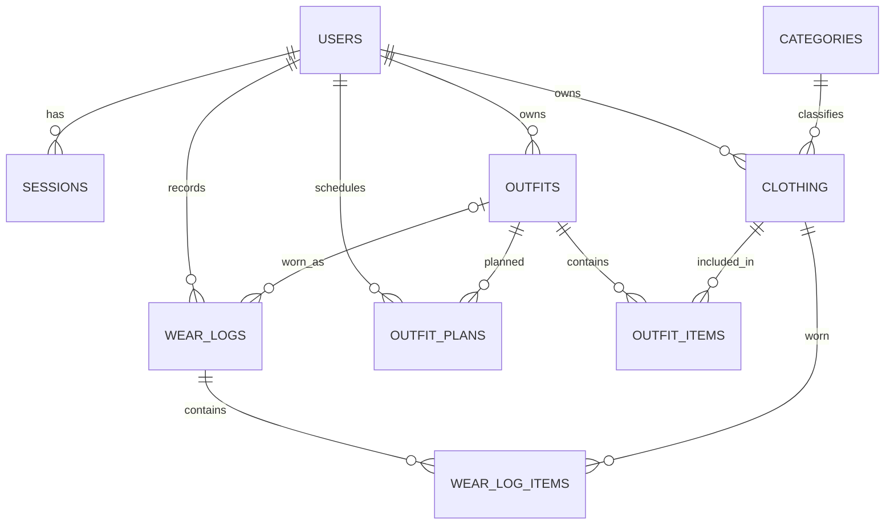

# Xây dựng và phát triển hệ thống quản lý tủ quần áo thông minh

Xây dựng ứng dụng web để số hóa tủ quần áo, quản lý outfit, ghi lại lịch sử mặc, lập lịch phối đồ, xem thống kê và nhận gợi ý phối đồ theo luật.

## 1. Mục tiêu và phạm vi

Ứng dụng cho phép người dùng:

- Đăng ký, đăng nhập và quản lý phiên bằng cookie bảo mật.
- Quản lý quần áo, danh mục, ảnh, mùa và loại trang phục.
- Lưu outfit từ các món quần áo trong tủ.
- Ghi nhật ký món đồ/outfit đã mặc và ghi chú theo ngày.
- Lên lịch outfit theo ngày và dịp; xem kế hoạch theo tháng.
- Xem Overview: số món chưa mặc, mức độ sử dụng, phân bố theo danh mục/mùa, lịch sắp tới và nhắc chăm sóc.
- Nhận gợi ý phối theo mùa, loại, màu và tần suất mặc từ dữ liệu của chính mình.

“Thông minh” trong phiên bản này có nghĩa là số hóa, lọc, thống kê và gợi ý theo các quy tắc minh bạch. Hệ thống **không** sử dụng AI/ML, nhận diện hình ảnh hay dự báo thời tiết.

## 2. Công nghệ

| Lớp | Công nghệ | Vai trò |
|---|---|---|
| Frontend | React 19, TypeScript, Vite | SPA và giao diện responsive |
| Điều hướng | React Router | Đường dẫn công khai và vùng cần đăng nhập |
| Gọi API | **Axios**, `async/await` | REST client, cookie credentials, CSRF header, chuẩn hóa lỗi |
| Server state | TanStack React Query, custom hook `useResource` | Cache, đồng bộ, loading/error/retry |
| Backend | NestJS 12, TypeScript, Express adapter | REST API theo module, xác thực và xử lý nghiệp vụ |
| Kiến trúc dữ liệu | TypeORM, MariaDB/MySQL driver | Repository/entity và giao dịch |
| Lưu ảnh | Filesystem riêng theo user ở development; Cloudinary tùy cấu hình production | Lưu/đọc ảnh |
| Proxy/triển khai | Vite proxy, Nginx, Docker Compose | Cùng nguồn `/api`, đóng gói dịch vụ |
| Kiểm thử | Jest, Vitest, ESLint, Oxlint, GitHub Actions | Unit tests, lint, build và CI |

## 3. Kiến trúc MVC và Layered Architecture

```text
Trình duyệt
 React pages/components → custom hook (React Query) → Axios
             ↓                    cookie + CSRF
      Vite proxy / Nginx → NestJS Controller → Service → TypeORM → MariaDB
```

Kiến trúc phân lớp tách giao diện, API, nghiệp vụ và truy cập dữ liệu. Theo MVC, React là **View**, entity/dữ liệu cùng quy tắc nghiệp vụ là **Model**, NestJS controller là **Controller**. Backend là REST API theo module, không phải MVC server-rendered.

## 4. Cơ sở dữ liệu và CRUD

### 4.1. Quan hệ đang triển khai

Database `digital_wardrobe` dùng MariaDB, gồm chín bảng:

| Bảng | Vai trò |
|---|---|
| `users` | Tài khoản và vai trò |
| `sessions` | Phiên có thể thu hồi, thời hạn đăng nhập |
| `categories` | Danh mục dùng chung |
| `clothing` | Quần áo theo chủ sở hữu, mùa, loại và thông tin chăm sóc |
| `outfits` | Outfit thuộc một người dùng |
| `outfit_items` | Quan hệ nhiều-nhiều giữa outfit và quần áo |
| `wear_logs` | Nhật ký mặc theo ngày |
| `wear_log_items` | Các món trong một lần ghi nhật ký |
| `outfit_plans` | Lịch outfit theo ngày/dịp |

Các khóa ngoại bảo vệ tính toàn vẹn; những quan hệ phụ thuộc sử dụng `ON DELETE CASCADE` hoặc `SET NULL` phù hợp. Schema mới ở [sql/digital_wardrobe.sql](./sql/digital_wardrobe.sql); migration cho database cũ ở [sql/migrations/](./sql/migrations).



### 4.2. Lựa chọn mô hình dữ liệu

MariaDB quan hệ là database duy nhất đang chạy, phù hợp với dữ liệu có quan hệ rõ và cần khóa ngoại/giao dịch. Document NoSQL có thể phù hợp metadata linh hoạt; Graph có thể hỗ trợ gợi ý qua nhiều quan hệ. Hai mô hình sau chỉ được phân tích, **chưa triển khai** vì chưa có nhu cầu đủ lớn để biện minh thêm hệ thống cần đồng bộ và vận hành.

### Vai trò người dùng

| Vai trò | Quyền |
|---|---|
| Khách | Xem nội dung công khai; đăng ký và đăng nhập |
| `user` | Quản lý quần áo, outfit, lịch sử mặc, kế hoạch và chăm sóc thuộc tài khoản |
| `admin` | Có quyền người dùng và quản lý danh mục dùng chung |

Tài khoản đăng ký mới mặc định là `user`. Hiện cấp quyền `admin` qua database; chưa có giao diện quản trị tài khoản.

Để cấp quyền cho tài khoản quản trị đầu tiên, đăng ký tài khoản trước rồi chạy bằng quyền database:

```sql
UPDATE users SET role = 'admin' WHERE email = 'admin@example.com';
```

### 4.3. CRUD

Quần áo, outfit, thành phần outfit, danh mục, nhật ký mặc và kế hoạch đều hỗ trợ CRUD. Hồ sơ hỗ trợ cập nhật tên/email; đổi mật khẩu yêu cầu mật khẩu hiện tại và thu hồi toàn bộ phiên. Thông tin chăm sóc được quản lý cùng món đồ.

## 5. API chính

Các endpoint dữ liệu yêu cầu cookie đăng nhập. Prefix `/api` là cấu hình proxy của frontend; NestJS nhận đường dẫn không có prefix đó.

| Nhóm | Method và route | Mục đích |
|---|---|---|
| Auth | `POST /auth/register`, `POST /auth/login` | Tạo tài khoản/phiên, đăng nhập |
| Auth | `GET /auth/session`, `POST /auth/logout`, `POST /auth/change-password` | Kiểm tra/thu hồi phiên, đổi mật khẩu |
| Profile | `GET/PATCH /user/me` | Hồ sơ người hiện tại |
| Quần áo | `GET/POST /clothing`, `GET/PATCH/DELETE /clothing/:id` | CRUD và lọc/phân trang |
| Ảnh | `POST /clothing/images` | Upload JPEG/PNG/WebP, tối đa 5 MB |
| Danh mục | `GET /category`, `GET /category/:id` | Đọc danh mục |
| Danh mục admin | `POST/PATCH/DELETE /category[/:id]` | Thay đổi danh mục |
| Outfit | `GET/POST /outfit`, `GET/PATCH/DELETE /outfit/:id` | CRUD outfit |
| Thành phần outfit | `GET/POST /outfit-item`, `GET/PATCH/DELETE /outfit-item/:id` | Ghép món vào outfit |
| Dashboard/gợi ý | `GET /activity/dashboard`, `GET /activity/recommendations` | Thống kê và gợi ý cá nhân |
| Nhật ký mặc | `GET/POST /activity/logs`, `PATCH/DELETE /activity/logs/:id` | CRUD lịch sử mặc |
| Lịch outfit | `GET/POST /activity/plans`, `PATCH/DELETE /activity/plans/:id` | CRUD kế hoạch; GET lọc theo khoảng ngày tối đa 366 ngày |
| Chăm sóc | `PATCH /activity/clothing/:id/care` | Cập nhật ngày giặt/ngưỡng nhắc/hướng dẫn |

`GET /clothing` hỗ trợ phân trang, tìm kiếm tên/màu/size trên toàn bộ dữ liệu, sắp xếp theo tên/màu, danh mục, mùa và loại (`top`, `bottom`, `outerwear`, `dress`, `shoes`, `accessory`).

## 6. Bảo mật

- Mật khẩu được băm bằng bcrypt; không lưu hoặc ghi log mật khẩu dạng rõ.
- Đổi mật khẩu yêu cầu xác minh mật khẩu hiện tại, băm mật khẩu mới và thu hồi mọi phiên đang hoạt động.
- JWT phiên được đặt trong cookie `HttpOnly`, `SameSite=Lax`, `Secure` ở production; thời hạn 15 phút.
- JWT chứa session ID; server kiểm tra session còn hiệu lực trong database cho request được bảo vệ. Logout thu hồi session ở server.
- Đăng nhập và đăng ký giới hạn 5 lần/phút cho mỗi IP; vượt giới hạn trả HTTP `429`. Bộ đếm dùng storage trong bộ nhớ của tiến trình, nên triển khai nhiều API replicas cần chuyển sang storage dùng chung.
- Cookie flags, HTTPS và khả năng thu hồi phiên giảm rủi ro chiếm dụng/tái sử dụng phiên; `HttpOnly` không bảo vệ thiết bị hoặc trình duyệt đã bị xâm nhập.
- CSRF guard yêu cầu `X-Wardrobe-Request: 1` với request thay đổi dữ liệu.
- Vai trò `admin` giới hạn quyền sửa danh mục.
- Service lấy `user_id` từ danh tính đã xác thực, không tin ID chủ sở hữu do client truyền. Outfit và quần áo phải cùng chủ sở hữu khi tạo liên kết.
- Ảnh lưu local theo user trong development; route đọc ảnh yêu cầu session và kiểm tra đúng chủ sở hữu. Production cần cấu hình Cloudinary; URL Cloudinary hiện không phải signed/private delivery.
- Thông báo lỗi máy chủ không trả stack trace/database detail cho trình duyệt.

Đây là biện pháp hiện có, không phải chứng nhận bảo mật. Trước production cần bổ sung quy trình đặt lại mật khẩu và quản lý admin an toàn; nếu chạy nhiều API replicas, cần dùng storage rate-limit dùng chung.

## 7. Luật – Đạo đức – Nghề nghiệp

Thiết kế và vận hành cần bảo vệ dữ liệu cá nhân (thu thập tối thiểu, giới hạn truy cập, không đưa mật khẩu/JWT/cookie vào log hoặc ảnh), tôn trọng bản quyền ảnh và thư viện, ghi nhận đóng góp trung thực, mô tả đúng giới hạn sản phẩm và xử lý sự cố có trách nhiệm. Trước khi nộp/triển khai, đối chiếu quy định hiện hành của Việt Nam và quy chế học thuật từ nguồn chính thức. Nội dung này là tổng quan học thuật, không phải tư vấn pháp lý.

## 8. Chạy ứng dụng

### Yêu cầu

- Node.js `>=24.9.0`
- npm
- MariaDB
- Git (để clone dự án)

### Chạy local

```bash
git clone https://github.com/Whales88888/Digital-Wardrobe-Group.git
cd Digital-Wardrobe-Group
npm --prefix frontend install
npm --prefix backend install
sudo service mariadb start
mariadb -u root -p < sql/digital_wardrobe.sql
cp -n backend/.env.example backend/.env
```

Điền cấu hình MariaDB và `JWT_SECRET` dài tối thiểu 32 ký tự trong `backend/.env`. Không commit `.env`. Trong terminal riêng:

```bash
npm --prefix backend run start:dev
npm --prefix frontend run dev
```

Mở URL Vite (thường `http://localhost:5173`). Vite proxy `/api` tới NestJS tại port `3000`. Có thể dùng task VS Code **Run Digital Wardrobe** nếu môi trường đã cấu hình task.

Ảnh development được lưu riêng theo user; production cần cấu hình Cloudinary.

### Docker Compose

Chuẩn bị `.env` gốc và `backend/.env` từ các file mẫu, điền các mật khẩu/secret thật rồi chạy:

```bash
docker compose up --build -d
```

Ứng dụng phục vụ tại `http://localhost:8080`; MariaDB lưu trong volume. Production cần HTTPS để cookie `Secure` hoạt động.

Với database cũ, sao lưu trước rồi áp dụng các migration trong [sql/migrations/](./sql/migrations/) theo thứ tự; không chạy lại migration đã áp dụng.

## 9. Kiểm thử và kiểm tra

```bash
npm run lint
npm test
npm run build
```

Kiểm tra gần nhất: lint và build thành công; backend unit tests **18 suites / 49 tests**, frontend **1 test file / 7 tests**, và HTTP integration tests **4 tests** đều đạt. HTTP integration tests kiểm tra CSRF, validation payload, ràng buộc chủ sở hữu và giới hạn đăng nhập với repository giả lập; chưa thay thế browser E2E hoặc kiểm thử MariaDB thật. CI chạy lint, unit tests, HTTP integration tests và build qua GitHub Actions.

## 10. Giới hạn đã biết

- Gợi ý là heuristic, không dùng AI; lịch chưa gửi thông báo hoặc đồng bộ lịch ngoài.
- Các danh sách outfit/danh mục chưa phân trang.
- Chưa có đặt lại mật khẩu, giao diện quản trị tài khoản hoặc browser E2E tests.
- Production cần cấu hình Cloudinary; ảnh chưa có signed/private delivery và asset chưa tự xóa khi xóa món đồ.

## 11. Tài liệu tham khảo

1. React và NestJS: https://react.dev/ · https://docs.nestjs.com/
2. Axios và TanStack Query: https://axios-http.com/docs/intro · https://tanstack.com/query/latest/docs/framework/react/overview
3. TypeORM và MariaDB: https://typeorm.io/ · https://mariadb.com/kb/en/documentation/
4. OWASP Authentication, Session Management và CSRF Cheat Sheets: https://cheatsheetseries.owasp.org/
5. IETF RFC 7519 — JSON Web Token: https://www.rfc-editor.org/rfc/rfc7519

## 12. Ảnh minh chứng

Ảnh minh chứng giao diện, API và cơ sở dữ liệu:


### Cơ sở dữ liệu


### Kết nối cơ sở dữ liệu


### Quản lý người dùng


### Quản lý danh mục


### Quản lý quần áo


### Quản lý trang phục


### Quản lý các món đồ trong trang phục


## Mã nguồn

[Whales88888/Digital-Wardrobe-Group](https://github.com/Whales88888/Digital-Wardrobe-Group)
